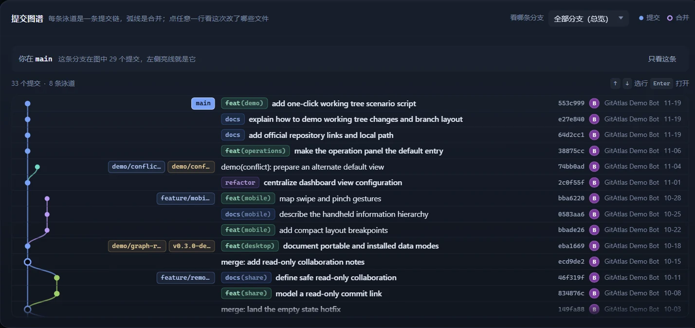
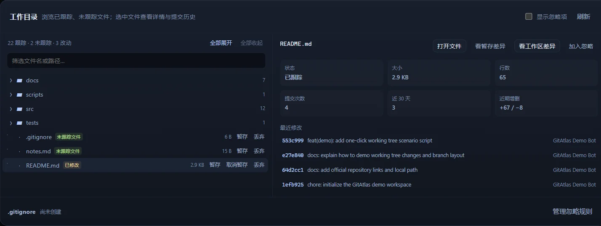

<p align="center">
  
</p>

<h1 align="center">GitAtlas</h1>

<p align="center"><strong>Commit graph and working directory for local Git repositories</strong></p>

<p align="center">
  <a href="LICENSE"></a>
  
  
</p>

<p align="center">
  <a href="#quick-start">Quick start</a> ·
  <a href="#features">Features</a> ·
  <a href="#explore-the-demo-repository">Demo repository</a> ·
  <a href="#project-layout">Project layout</a>
</p>

<p align="center"><a href="README.md">简体中文</a> · English</p>

GitAtlas is a visual tool for local Git repositories. After adding a repository you can read branches and merge history, review per-file diffs, and stage, commit, and resolve conflicts — without typing commands. The Windows desktop build and the browser UI share the same workflow.



## Quick start

### Windows desktop

The desktop build adds repositories through a native folder picker. Install [Git for Windows](https://git-scm.com/download/win) first and make sure `git` is on your `PATH`.

| Windows x64 artifact | How to run it | Where the index is stored |
| --- | --- | --- |
| `GitAtlas-Portable-<version>.exe` | Run it directly | `data/` next to the executable |
| `GitAtlas-Setup-<version>.exe` | Run the installer | `%APPDATA%\GitAtlas\data\` |

You can build the desktop app from source today; the artifacts land in `release/`. Published builds are listed on the [releases page](https://github.com/KnifeWen007/GitAtlas/releases).

### Run from source

You need Git, Node.js 22.18+ (24 LTS recommended), and pnpm 10. Clone the repository and start the desktop development mode.

```sh
git clone https://github.com/KnifeWen007/GitAtlas.git
cd GitAtlas
pnpm install
pnpm dev
```

Browser development mode uses two terminals. Start the API and the front end from the repository root, then open [http://127.0.0.1:5317](http://127.0.0.1:5317).

```sh
pnpm dev:server  # API · 127.0.0.1:4317
pnpm dev:web     # Vite · 127.0.0.1:5317
```

Build the desktop app from source on Windows.

```sh
pnpm build:desktop:dir   # writes release/win-unpacked/
pnpm build:desktop       # writes the portable build and the installer
```

## Features

| Feature | What you can do |
| --- | --- |
| **Commit graph** | Browse branch lanes, merge edges, and tags; focus a branch tip to see how far ahead or behind it is. Select a commit to inspect its changed files and line-by-line diffs. |
| **Working directory** | Browse tracked, untracked, and ignored files, open a directory's details, and search the whole repository by file name or path. The file list shows 200 entries per page. |
| **File actions** | Stage, unstage, or discard changes from the file tree. The built-in editor saves UTF-8 text up to 512 KB, and the desktop build can hand a file to the system default application. |
| **File history and ignore rules** | Jump from a file's history into the matching commit diff, including paths from before a rename. See where an ignore rule comes from, and edit `.gitignore` at the repository root or in a subdirectory. |
| **Git operations** | Fetch, pull, and push; manage branches and tags; commit with Conventional Commits; edit merge conflicts; and restore a rollback point. |
| **Repository overview** | Review commit and contributor statistics, lines added and removed, and an activity heatmap. Switch the sidebar between Simplified Chinese and English, and choose a dark, light, or follow-system theme. |



## Explore the demo repository

Clone the demo repository, then click "Add repository" in GitAtlas and pick the cloned folder. [GitAtlas-Demo](https://github.com/KnifeWen007/GitAtlas-Demo)

```sh
git clone https://github.com/KnifeWen007/GitAtlas-Demo.git
```

Start by picking a branch in the commit graph and opening a merge commit to see its diff. Then switch to the working directory, search for `README.md`, and open one of its history commits from the file details panel.

## Project layout

| Directory | Purpose |
| --- | --- |
| [`apps/web`](apps/web/) | React + Vite interface |
| [`apps/desktop`](apps/desktop/) | Electron main process, native folder picker, and Windows packaging |
| [`packages/server`](packages/server/) | Fastify API, asynchronous indexing jobs, and progress reporting |
| [`packages/core`](packages/core/) | Git reads and writes, indexing, graph analysis, and SQLite storage |

```sh
pnpm typecheck       # checks core, server, and web
pnpm test            # unit tests plus integration tests against temporary Git repositories
pnpm atlas doctor    # inspects the Git setup
pnpm atlas list      # lists indexed repositories
```

When you run the API on its own, `HOST`, `PORT`, `ATLAS_DB`, and `ATLAS_GIT` override the listen address, port, database, and Git executable. The default listen address is `127.0.0.1:4317`, and the index is written to `data/atlas.db`.

Design documents cover the application architecture, interaction flows, and data model: [architecture](docs/architecture.md) · [interaction flows](docs/ux-flows.md) · [data model](docs/data-model.md).

Incremental indexing, issue detection, account permissions, and a PWA are on the roadmap: [project roadmap](PLAN.md).

## License

GitAtlas is released under the MIT license. Keep the copyright notice and the license text when you use, modify, or redistribute it. [LICENSE](LICENSE)