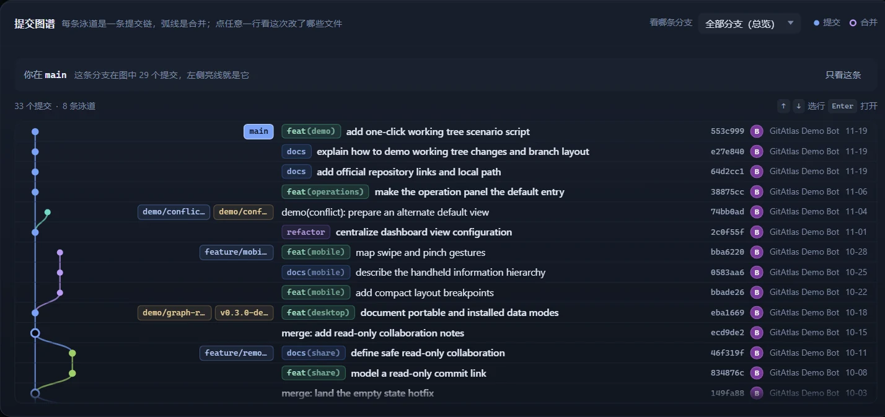
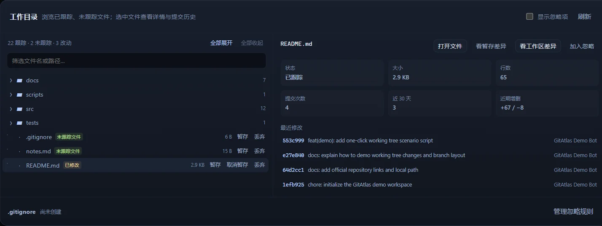

<p align="center">
  
</p>

<h1 align="center">GitAtlas</h1>

<p align="center"><strong>本地 Git 仓库的提交图谱与工作目录</strong></p>

<p align="center">
  <a href="LICENSE"></a>
  
  
</p>

<p align="center">
  <a href="#快速开始">快速开始</a> ·
  <a href="#功能">功能</a> ·
  <a href="#体验演示仓库">演示仓库</a> ·
  <a href="#项目结构">项目结构</a>
</p>

<p align="center">简体中文 · <a href="README.en.md">English</a></p>

GitAtlas 是一个面向本地 Git 仓库的可视化工具。添加仓库后，可以查看分支和合并关系、浏览逐文件差异，并完成暂存、提交和冲突处理。Windows 桌面版和浏览器界面共用同一套工作流。



## 快速开始

### Windows 桌面版

桌面版通过原生目录选择器添加已有的本地仓库。使用前请安装 Git for Windows，并确认 `git` 在 PATH 中。[Git for Windows](https://git-scm.com/download/win)

| Windows x64 产物 | 运行方式 | 索引数据位置 |
| --- | --- | --- |
| `GitAtlas-Portable-<版本>.exe` | 直接运行 | 可执行文件旁的 `data/` |
| `GitAtlas-Setup-<版本>.exe` | 运行安装程序 | `%APPDATA%\GitAtlas\data\` |

当前可从源码构建 Windows 桌面版，产物位于 `release/`。公开版本会列在发布页。[GitHub Releases](https://github.com/KnifeWen007/GitAtlas/releases)

### 从源码运行

准备 Git、Node.js 22.18+（推荐 24 LTS）和 pnpm 10。克隆项目后开启桌面开发模式。

```sh
git clone https://github.com/KnifeWen007/GitAtlas.git
cd GitAtlas
pnpm install
pnpm dev
```

浏览器开发模式使用两个终端。从仓库根目录分别启动 API 和前端，然后打开 [http://127.0.0.1:5317](http://127.0.0.1:5317)。

```sh
pnpm dev:server  # API · 127.0.0.1:4317
pnpm dev:web     # Vite · 127.0.0.1:5317
```

在 Windows 上从源码构建桌面版。

```sh
pnpm build:desktop:dir   # 生成 release/win-unpacked/
pnpm build:desktop       # 生成便携版和安装包
```

## 功能

| 功能 | 可以做什么 |
| --- | --- |
| **提交图谱** | 浏览分支泳道、合并连线和标签，聚焦分支头并查看领先与落后。点选提交即可查看变更文件和逐行差异。 |
| **工作目录** | 浏览跟踪、未跟踪和忽略的文件，查看目录详情，按文件名或路径搜索整个仓库。文件列表每页显示 200 项。 |
| **文件操作** | 在文件树暂存、取消暂存或丢弃改动。内置编辑器支持保存 512 KB 以内的 UTF-8 文本，桌面端也可以调用系统默认程序。 |
| **文件历史与忽略规则** | 从文件历史跳到对应提交的差异，包含重命名前的路径。查看规则来源，编辑根目录和子目录的 `.gitignore`。 |
| **Git 操作台** | 获取、拉取、推送、管理分支和标签、按 Conventional Commits 提交、编辑合并冲突，以及恢复到回滚点。 |
| **仓库概览** | 查看提交与贡献者统计、代码增删和活动热力图。在左侧栏切换简体中文与 English，并设置深色、浅色或跟随系统。 |



## 体验演示仓库

克隆演示仓库后，在 GitAtlas 点「添加仓库」，选择克隆得到的本地目录。[GitAtlas-Demo](https://github.com/KnifeWen007/GitAtlas-Demo)

```sh
git clone https://github.com/KnifeWen007/GitAtlas-Demo.git
```

先从提交图谱选择一条分支，点选一次合并提交查看差异。再打开工作目录，搜索 `README.md`，从文件详情进入某次历史提交。

## 项目结构

| 目录 | 用途 |
| --- | --- |
| [`apps/web`](apps/web/) | React + Vite 界面 |
| [`apps/desktop`](apps/desktop/) | Electron 主进程、原生目录选择与 Windows 打包 |
| [`packages/server`](packages/server/) | Fastify API、异步索引任务与进度 |
| [`packages/core`](packages/core/) | Git 读取和写操作、索引、图谱分析与 SQLite 存储 |

```sh
pnpm typecheck       # 检查 core、server 和 web
pnpm test            # 运行单元测试和临时 Git 仓库集成测试
pnpm atlas doctor    # 检查 Git 环境
pnpm atlas list      # 列出已索引的仓库
```

独立运行 API 时可用 `HOST`、`PORT`、`ATLAS_DB` 和 `ATLAS_GIT` 调整监听地址、端口、数据库和 Git 可执行文件。默认监听 `127.0.0.1:4317`，索引写入 `data/atlas.db`。

设计文档包括应用架构、交互流程和数据模型。[架构](docs/architecture.md) · [交互流程](docs/ux-flows.md) · [数据模型](docs/data-model.md)

增量索引、问题检测、账户权限与 PWA 列在项目路线图中。[项目路线图](PLAN.md)

## 许可证

GitAtlas 使用 MIT 许可证。使用、修改和分发时请保留版权声明与许可文本。[LICENSE](LICENSE)
